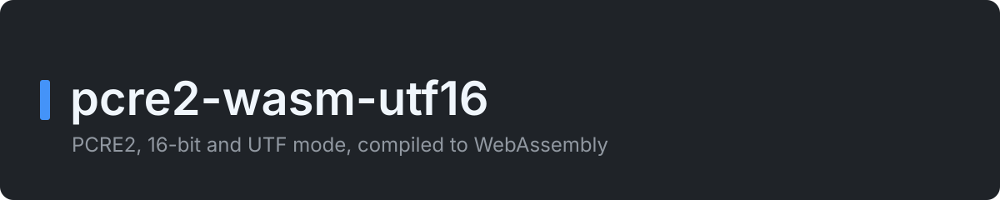

<p align="center">
  
</p>

<p align="center">
  <a href="https://github.com/Bimmiest/pcre2-wasm-utf16/actions/workflows/ci.yml"></a>
  <a href="https://github.com/Bimmiest/pcre2-wasm-utf16/actions/workflows/security.yml"></a>
  <a href="https://scorecard.dev/viewer/?uri=github.com/Bimmiest/pcre2-wasm-utf16"></a>
  <a href="LICENSE"></a>
</p>

# pcre2-wasm-utf16

[PCRE2](https://github.com/PCRE2Project/pcre2) compiled to WebAssembly, for
code in a browser, a worker or Node that must run PCRE patterns.

## Highlights

- **Offsets are JS string indices.** The 16-bit library in UTF mode gets the
  UTF-16 code units of a JS string with no change. Nothing is transcoded to
  UTF-8.
- **Built here, from a pinned release.** CI rebuilds the module from PCRE2
  10.48 and fails if the result is not byte-identical to the committed file.
- **No emscripten and no JS glue.** The module imports nothing, and it runs
  in each environment that has WebAssembly.
- **Limits that hold.** Match, depth and heap limits stop a runaway pattern
  with an error, not a hung tab.
- **Small.** The module is approximately 300 KB, and 80 KB with gzip.

## Overview

The package gives a `Regex` class with `exec`, `test`, `matchAll`,
`substitute` and `replace`. A match has the shape of a `RegExpExecArray` with
the `d` flag. You load the module one time with `init` or `initSync`. You
give it the bytes or a compiled `WebAssembly.Module`, because the package
does not fetch or read files. It was written for
[propslab](https://github.com/Bimmiest/propslab), which runs the regexes of
Splunk on it.

**Maturity.** The version is 0.1.0, before 1.0. A breaking change increments
the minor version.

**What it is not:**

- It is not on npm. Install it from a release tag.
- It ships TypeScript source, not compiled JavaScript. Import it through a
  tool that compiles TypeScript, for example Vite, Vitest or esbuild. Plain
  `node` cannot import it, because Node does not strip types from files in
  `node_modules`.
- It has no JIT, because WebAssembly has no JIT for PCRE2. Each match runs
  the interpreter of PCRE2.
- The garbage collector does not free wasm memory. Call `free()` on each
  `Regex` that you do not need again.

## Demo

```ts
import { readFileSync } from 'node:fs';
import { initSync, Regex } from 'pcre2-wasm-utf16';

initSync(readFileSync(new URL('../pcre2.wasm', import.meta.url)));

const re = new Regex('(?<key>\\w+)=(?<value>\\S+)');
const m = re.exec('é😀 a=1');
m?.index; // 4: the JS index, after the two units of 😀
m?.groups?.value; // '1'
re.substitute('a=1 b=2', '${value}=${key}', { global: true }); // '1=a 2=b'
re.free();
```

## Usage

```ts
await init(WebAssembly.compileStreaming(fetch(new URL('pcre2-wasm-utf16/pcre2.wasm', import.meta.url))));
new Regex('a+', 'i').test('xAAy'); // true
```

[docs/api.md](docs/api.md) tells you how to load the module in a browser, a
worker and Node, and gives the flags, the semantics and the limits.

## Installation

```bash
npm install github:Bimmiest/pcre2-wasm-utf16#v0.1.0
```

To work on the package:

```bash
nvm use    # the Node version in .nvmrc
npm ci
npm run lint && npm run format:check && npm run typecheck && npm run test:coverage && npm run build
```

Requirements: Node, at the version in [`.nvmrc`](.nvmrc). To rebuild
`pcre2.wasm`, you also need clang 18 and `wasm-ld`
([docs/building.md](docs/building.md)).

## Documentation

| Document | What it holds |
|---|---|
| [docs/api.md](docs/api.md) | How to load the module, the `Regex` API, the flags, the semantics, the limits and the memory |
| [docs/building.md](docs/building.md) | How `build/build.sh` makes `pcre2.wasm`, how CI proves it, and how to upgrade PCRE2 |
| [docs/testing.md](docs/testing.md) | What each test file tests, and how to read a mutation run |
| [docs/repository-settings.md](docs/repository-settings.md) | The repository settings that are not files, and that `settings.yml` checks |
| [CONTRIBUTING.md](CONTRIBUTING.md) | How work happens here: branches, commits, tests, style, dependencies and releases |
| [docs/adr/](docs/adr/README.md) | The decisions, and why we made them |
| [CHANGELOG.md](CHANGELOG.md) | What changed for a user, newest first |
| [SECURITY.md](SECURITY.md) | How to report a vulnerability, and what is in scope |
| [CODE_OF_CONDUCT.md](CODE_OF_CONDUCT.md) | The Contributor Covenant, enforced through the security contact |

## Contributing and feedback

To report a bug or to suggest a change, open an issue. Before you open a pull
request, read [CONTRIBUTING.md](CONTRIBUTING.md).

## Licence

| File | What it covers | What it obliges |
|---|---|---|
| [LICENSE](LICENSE) | The wrapper (`src/`), the bridge and libc (`build/`), and the build script: MIT | Keep the copyright notice |
| [LICENCE-PCRE2.md](LICENCE-PCRE2.md) | PCRE2, which is compiled into `pcre2.wasm`: BSD-3-Clause with the PCRE2 exception | Keep the notices with the binary. `NOTICE` and the package carry them |

[NOTICE](NOTICE) tells you which licence applies to which file.
